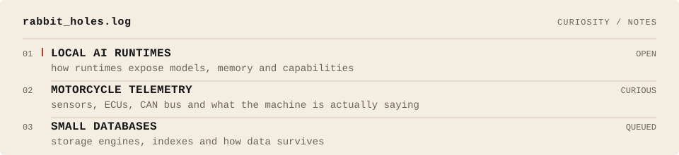

<picture>
  <source media="(prefers-color-scheme: dark)" srcset="./assets/ak-node-dark.svg">
  <source media="(prefers-color-scheme: light)" srcset="./assets/ak-node-light.svg">
  
</picture>

**I like knowing how the whole thing works.**

I work across backend systems, full-stack development, infrastructure, and the pieces between them.

When I'm away from code, I'm usually reading about some interesting project, exploring how something was built, or obsessing over motorcycles. 🏍️

[Portfolio ↗](https://ashutoshkumar2000.github.io/) · [LinkedIn ↗](https://www.linkedin.com/in/ashutosh-kumar-58197a153)

 

<!--
Garage maintenance (local; no npm install needed):
Edit garage.json: current_build, rabbit_hole, ride_mode, on_the_bench, offline_mode.
Run npm run profile; commit the data and both generated SVGs together.
npm run profile:check verifies generated assets without changing files.
Layout: scripts/garage.svg.template. Fixed slots: 4 modes, 2 bench rows, 3 offline labels.
Descriptions wrap to two lines; the generator rejects content that exceeds the layout.
-->
<picture>
  <source media="(prefers-color-scheme: dark)" srcset="./assets/garage-dark.svg">
  <source media="(prefers-color-scheme: light)" srcset="./assets/garage-light.svg">
  
</picture>

 

<!--
Rabbit-hole maintenance: edit profile/rabbit-holes.json, then npm run profile:rabbit-holes.
No npm install needed. Commit the data and both generated SVGs together.
Check without writing: npm run profile:rabbit-holes:check.
Layout: scripts/rabbit-holes.svg.template. Three records; titles ≤48 characters, notes ≤90.
Statuses: OPEN / CURIOUS / QUEUED, with at most one OPEN. Notes stay at 14px; shorten long copy.
-->
<picture>
  <source media="(prefers-color-scheme: dark)" srcset="./assets/rabbit-holes-dark.svg">
  <source media="(prefers-color-scheme: light)" srcset="./assets/rabbit-holes-light.svg">
  
</picture>
