<picture>
  <source media="(prefers-color-scheme: dark)" srcset="./assets/ak-node-dark.svg">
  <source media="(prefers-color-scheme: light)" srcset="./assets/ak-node-light.svg">
  
</picture>

## Hey, I'm Ashutosh.

**I like knowing how the whole thing works.**

I'm a Lead Software Engineer working across backend systems, full-stack development, infrastructure, and the pieces between them.

When I'm away from code, I'm usually reading about some interesting new project or obsessing over motorcycles. 🏍️

[Portfolio ↗](https://ashutoshkumar2000.github.io/) · [LinkedIn ↗](https://www.linkedin.com/in/ashutosh-kumar-58197a153)
